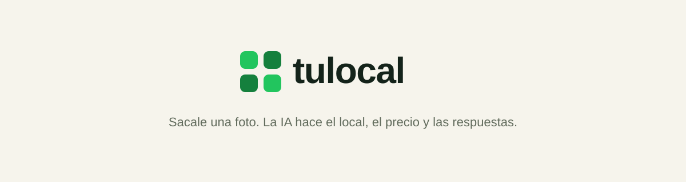

[![TypeScript][typescript-shield]][typescript-url]
[![Bun][bun-shield]][bun-url]
[![Next.js][nextjs-shield]][nextjs-url]
[![Postgres][postgres-shield]][postgres-url]
[![Drizzle][drizzle-shield]][drizzle-url]
[![Tailwind CSS][tailwind-shield]][tailwind-url]

 

  

  

     
     
    <a href="documentation">Explorar la documentación »</a>
  

## El problema

Emprendedores y gente que vende algo suelto (la bici, el celu viejo, el sillón que no entra) no tienen tiempo ni ganas de armar una publicación: sacar buenas fotos, escribir una descripción, decidir un precio, y después contestar el mismo "¿todavía lo tenés?" veinte veces por WhatsApp.

## La solución

**tulocal** convierte un puñado de fotos sacadas con el celular en una tienda online lista para compartir. La IA identifica el producto, genera fotos mejoradas, escribe el título y la descripción, y sugiere un precio con comparables reales del mercado. Cada tienda tiene su propia URL y un agente de IA con personalidad propia que responde preguntas y negocia con los compradores, sin nunca bajar del precio mínimo secreto que fija el vendedor.

No es un marketplace: no hay catálogo central ni comisión. Cada vendedor trae sus propios compradores, tulocal solo hace el trabajo pesado de publicar y atender.

 

Hecho para la hackathon de <a href="https://x.com/remolitoral">Remo Litoral</a>

<!-- MARKDOWN LINKS & IMAGES -->

[typescript-shield]: https://img.shields.io/badge/TypeScript-3178C6?style=for-the-badge&logo=typescript&logoColor=white
[typescript-url]: https://www.typescriptlang.org/
[bun-shield]: https://img.shields.io/badge/Bun-000000?style=for-the-badge&logo=bun&logoColor=white
[bun-url]: https://bun.sh/
[nextjs-shield]: https://img.shields.io/badge/Next.js-000000?style=for-the-badge&logo=nextdotjs&logoColor=white
[nextjs-url]: https://nextjs.org/
[postgres-shield]: https://img.shields.io/badge/Postgres-4169E1?style=for-the-badge&logo=postgresql&logoColor=white
[postgres-url]: https://neon.tech/
[drizzle-shield]: https://img.shields.io/badge/Drizzle-C5F74F?style=for-the-badge&logo=drizzle&logoColor=black
[drizzle-url]: https://orm.drizzle.team/
[tailwind-shield]: https://img.shields.io/badge/Tailwind_CSS-06B6D4?style=for-the-badge&logo=tailwindcss&logoColor=white
[tailwind-url]: https://tailwindcss.com/
